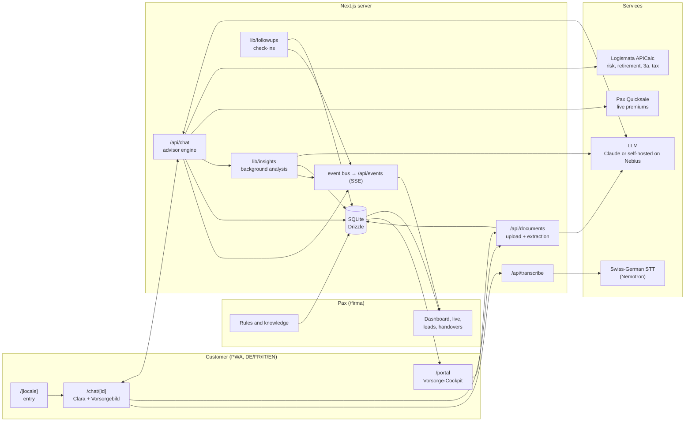
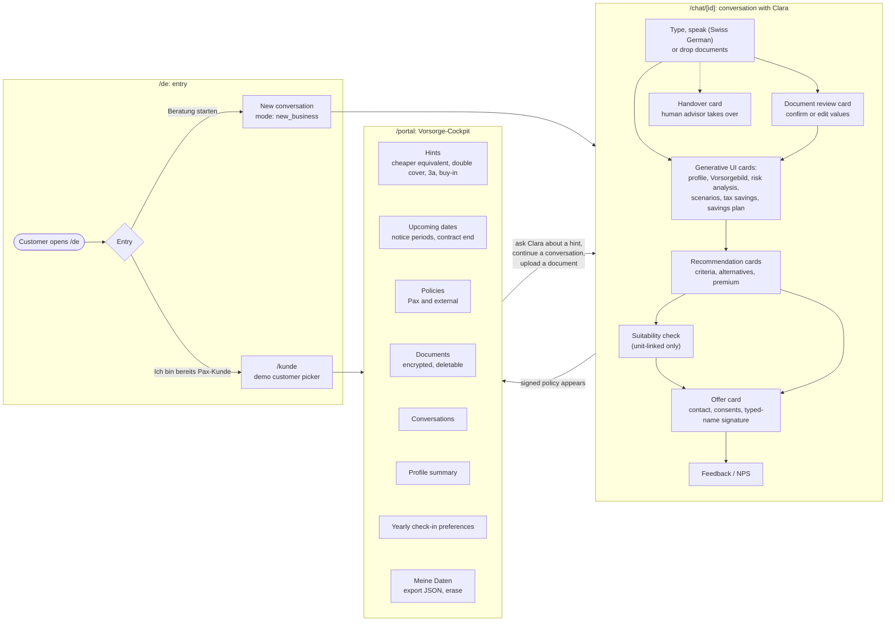
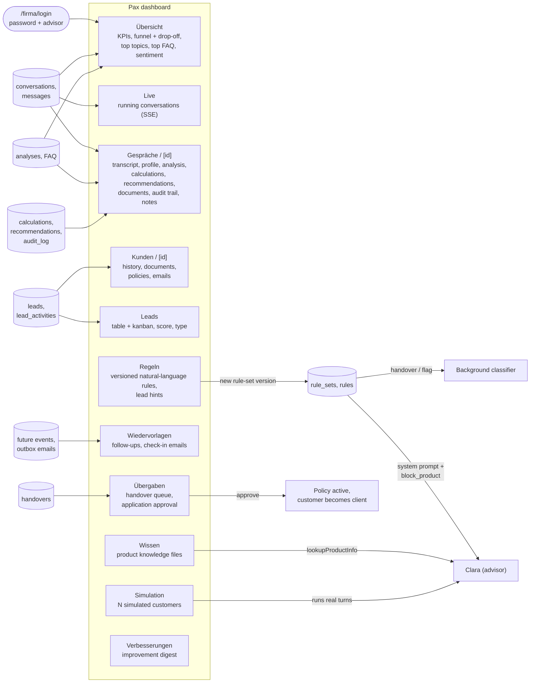
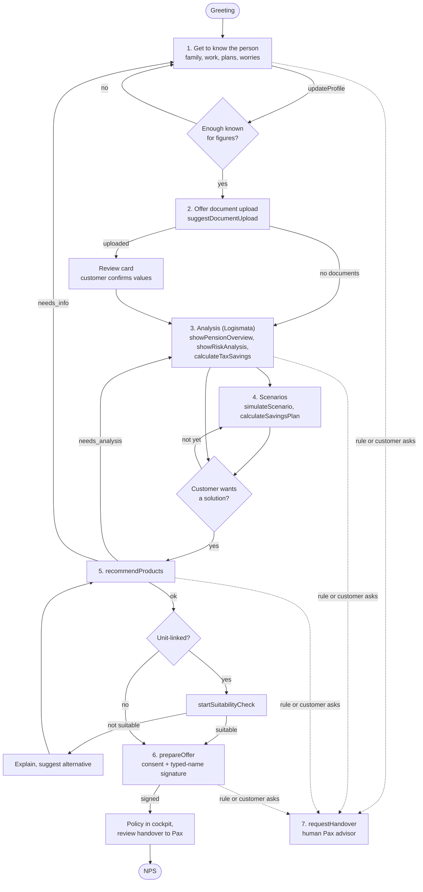
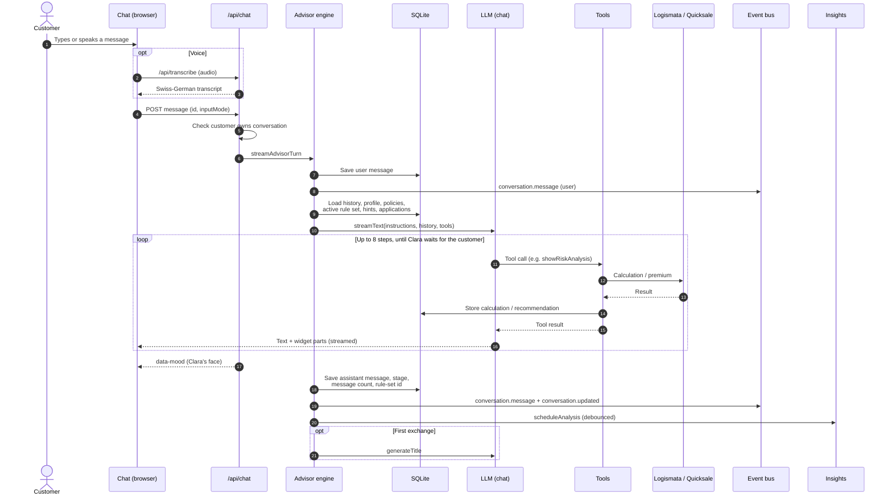
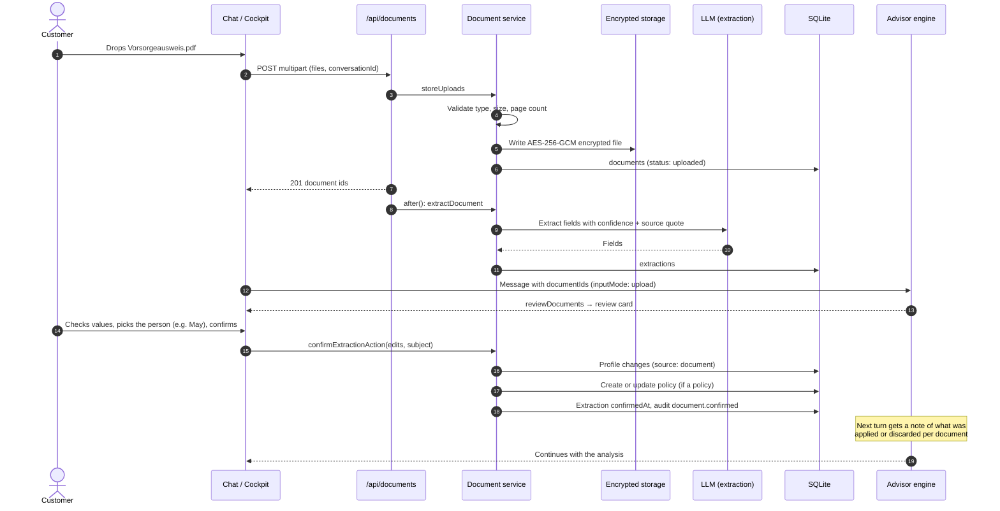
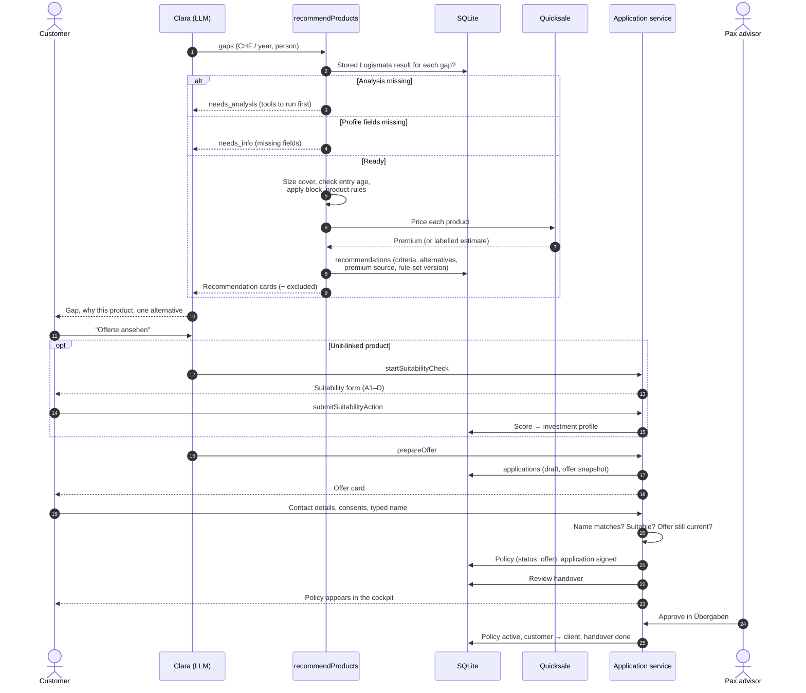
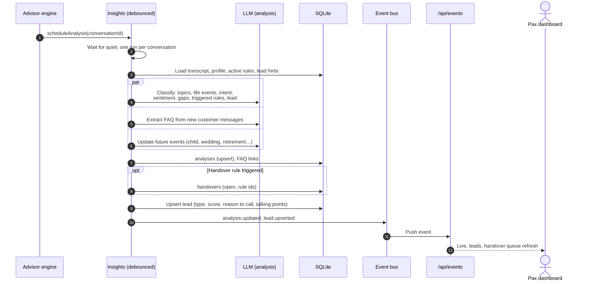
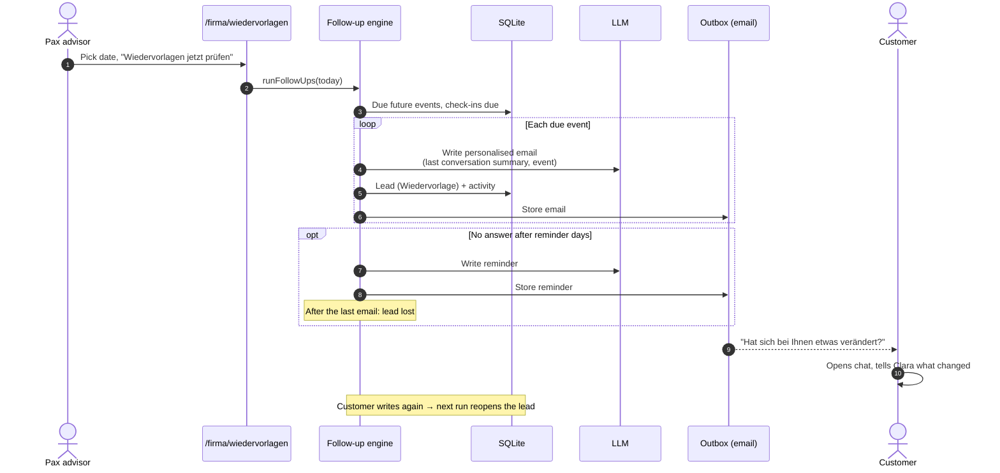

# Pax Clara: diagrams

Flow charts and sequence diagrams for the two sides of the app: the customer's view and the Pax
view. They complement [`ARCHITECTURE.md`](ARCHITECTURE.md), which has the tables, modules and
privacy rules. All diagrams are Mermaid and render on GitHub.

## Contents

1. [System overview](#1-system-overview)
2. [Customer view](#2-customer-view)
3. [Pax view](#3-pax-view)
4. [Conversation flow](#4-conversation-flow)
5. [Funnel stages](#5-funnel-stages)
6. [Sequence: one advisor turn](#6-sequence-one-advisor-turn)
7. [Sequence: document upload and confirmation](#7-sequence-document-upload-and-confirmation)
8. [Sequence: recommendation to signed policy](#8-sequence-recommendation-to-signed-policy)
9. [Sequence: background analysis, leads and handovers](#9-sequence-background-analysis-leads-and-handovers)
10. [Sequence: yearly check-in and Wiedervorlage](#10-sequence-yearly-check-in-and-wiedervorlage)

---

## 1. System overview

---

## 2. Customer view

What a customer sees and where each action leads.

---

## 3. Pax view

The company dashboard at `/firma` (shared password, then pick a seeded advisor). Each page and
what feeds it.

---

## 4. Conversation flow

Clara's conversation design. The analysis gate before products is enforced in code
(`recommendProducts` returns `needs_analysis`), not only in the prompt.

---

## 5. Funnel stages

Stages only move forward (`advanceStage`). A turn reaches a stage through profile completeness or
the tools it completed (`lib/advisor/stage.ts`).

```mermaid
stateDiagram-v2
    direction LR
    [*] --> started
    started --> getting_to_know: first customer message
    getting_to_know --> situation_captured: profile ≥ 70 %
    situation_captured --> analysis_shown: pension overview, risk,<br/>tax or capital payout
    analysis_shown --> scenario_explored: scenario or savings plan
    analysis_shown --> recommendation_shown: recommendProducts
    scenario_explored --> recommendation_shown: recommendProducts /<br/>suitability check
    recommendation_shown --> offer_viewed: prepareOffer
    offer_viewed --> application_started: contact / consent
    application_started --> signed: signature
    signed --> [*]
```

---

## 6. Sequence: one advisor turn

`POST /api/chat` → `streamAdvisorTurn` (`lib/advisor/engine.ts`). The stream is teed so the turn
finishes and persists even when the browser leaves mid-answer.

---

## 7. Sequence: document upload and confirmation

Nothing extracted is used until the customer confirms it in the review card.

---

## 8. Sequence: recommendation to signed policy

---

## 9. Sequence: background analysis, leads and handovers

After every turn the conversation is classified in the background (`lib/insights`). The rules
the company writes in `/firma/regeln` decide handovers.

---

## 10. Sequence: yearly check-in and Wiedervorlage

`runFollowUps` (`lib/followups/engine.ts`) is idempotent for a given day, so the dashboard can run
it on demand, also with a simulated date for the demo.

