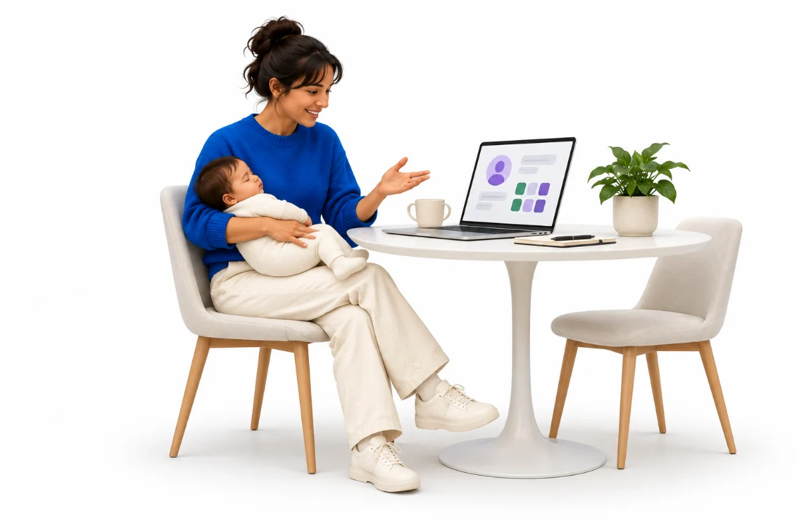
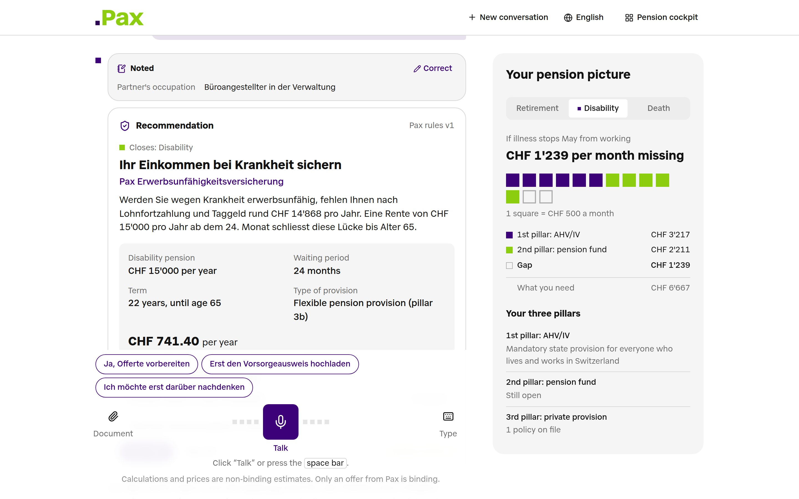
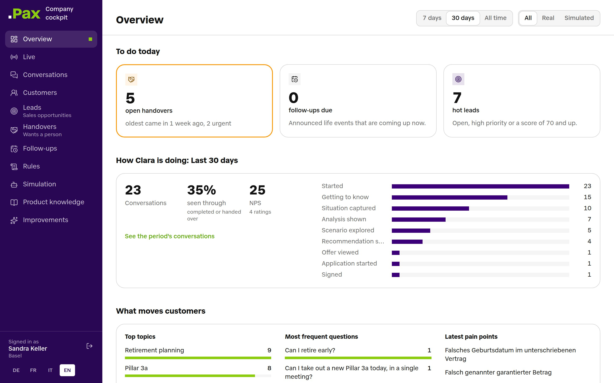

<p align="center">
  
</p>

<h1 align="center">Pax Clara</h1>

<p align="center">
  <b>A digital pension advisor that starts with your life, not a product.</b><br>
  BaselHack 2026 · Pax challenge "AI that makes life insurance simple" · Team A4: Joel Müller, Flurin Laim
</p>

<p align="center">
  DE · FR · IT · EN &nbsp;|&nbsp; Swiss-German voice &nbsp;|&nbsp; real Swiss calculations &nbsp;|&nbsp; runs on our own GPU
</p>

---

## Meet Clara.



One evening, Jane asks Clara what would happen to her family if something happened to May.
In Swiss German.

Clara first gets to know them, then shows the gap across all three pillars, and only then
recommends a Pax product, with the reasons behind it and a live premium.

The Müllers closed their gap in one conversation: **CHF 741 a year**, about two francs a day.

<br clear="right">

## How it works

| | |
|---|---|
| 💬 **Get to know** | Family, work, plans and worries come before any number or product. |
| 📊 **See the picture** | Logismata calculates retirement, disability and death across all three pillars. |
| 🔀 **Play it through** | A child, a home, early retirement: what changes? |
| 🛡️ **Close the gap** | A Pax product with criteria, alternatives and a Quicksale premium, signed in the app. |
| 🤝 **Hand over** | A human Pax advisor takes over when a rule or the customer asks for it. |

## Two sides

<table>
  <tr>
    <td width="50%"></td>
    <td width="50%"></td>
  </tr>
  <tr>
    <td><b>For the customer:</b> a conversation, the Vorsorgebild, and the policy in their Vorsorge-Cockpit.</td>
    <td><b>For Pax:</b> leads, handovers, funnel drop-offs and the audit trail of every conversation.</td>
  </tr>
</table>

## Run it

```bash
cd code
pnpm install
cp .env.example .env.local   # ANTHROPIC_API_KEY, LOGISMATA_API_TOKEN, SESSION_SECRET, DOCUMENT_ENCRYPTION_KEY
pnpm db:reset                # SQLite in code/data: advisors, rule set v1, demo customers
pnpm dev                     # http://localhost:3000/de
```

| URL | What |
|---|---|
| `/de` | Start a consultation, or "Ich bin bereits Pax-Kunde" to pick a demo customer |
| `/de/portal` | Vorsorge-Cockpit: policies, documents, hints, conversations |
| `/de/firma` | Company dashboard  |

Demo scripts for the seeded personas: [`documentation/DEMO_PERSONAS.md`](documentation/DEMO_PERSONAS.md).

## Self-hosted mode

One setting switches all model calls to a GPU we rent from Nebius, so customer data does not go to
an external AI provider:

- **Conversation:** Nemotron 3.5 Bolt 74B-A9B (24GB) on an NVIDIA B200.
- **Speech-to-text:** our fine-tuned Swiss-German model, on the same GPU.

The setting is `LLM_PROVIDER=openai-compatible` with `LLM_BASE_URL` pointing at the endpoint, and
`STT_BASE_URL` for speech. For the hackathon the GPU runs in Nebius `us-central1`; it can be rented
in an EU region with `--region` ([`documentation/cookbook/nebius-nemotron`](documentation/cookbook/nebius-nemotron/README.md)),
which we did not do because of the price. Calculations (Logismata) and pricing (Quicksale) are
external services in either mode.

## The journey

**advisory → recommendation → contract → policy in the portal**, end to end:

1. **Getting to know you.** Clara asks about the person before any numbers or products.
2. **Numbers, with a shortcut.** Upload a Vorsorgeausweis, policy or Lohnausweis instead of
   typing figures. Extracted values are only used after the customer confirms them.
3. **Analysis.** Logismata risk check (disability, death) and retirement check across all three
   pillars, shown as the Vorsorgebild and gap charts, plus 3a tax savings.
4. **Scenarios.** A child, buying a home with 3a or pension-fund money, early retirement.
5. **Recommendation.** Gap → product, with criteria, alternatives and a Quicksale premium.
   Unit-linked products need the suitability check first.
6. **Contract.** Offer summary → consent → typed-name signature → policy in the cockpit.
7. **Handover** to a human advisor whenever a company rule or the customer asks for it.

Architecture, data model and design decisions: [`documentation/ARCHITECTURE.md`](documentation/ARCHITECTURE.md).

## Legal Framework: where it is implemented

| Requirement | How | Where |
|---|---|---|
| Recommendations are explainable, documented, auditable | Each recommendation is stored with the gap, criteria, alternatives, inputs, premium source, model id and rule-set version; every Logismata and Quicksale call is stored with input and output | [`code/src/lib/sales/recommend.ts`](code/src/lib/sales/recommend.ts), `recommendations` and `calculations` in [`code/src/lib/db/schema.ts`](code/src/lib/db/schema.ts) |
| Logging | Audit log for AI and human actions (recommendations, offers, signatures, document access, handovers, rule changes, lead changes), shown per conversation in the dashboard | [`code/src/lib/audit.ts`](code/src/lib/audit.ts), [`records-section.tsx`](code/src/components/firma/conversation/records-section.tsx) |
| Human review stays possible | The advisor hands over when an active company rule applies (it cites the rule ids), when the customer asks, or when the case is complex. Rules are plain language, versioned and edited by Pax | [`code/src/lib/advisor/tools/handover.ts`](code/src/lib/advisor/tools/handover.ts), [`code/src/lib/rules/active.ts`](code/src/lib/rules/active.ts), `/firma/uebergaben`, `/firma/regeln` |
| Encryption | Uploaded documents are encrypted at rest with AES-256-GCM, the document id bound as authenticated data; the customer can delete them | [`code/src/lib/documents/crypto.ts`](code/src/lib/documents/crypto.ts), [`code/src/app/api/documents/[id]/route.ts`](code/src/app/api/documents/%5Bid%5D/route.ts) |
| Access protection | Signed HMAC customer cookie; company dashboard behind a password with a constant-time check, server actions re-check the advisor | [`code/src/lib/auth/signing.ts`](code/src/lib/auth/signing.ts), [`code/src/lib/firma/auth.ts`](code/src/lib/firma/auth.ts) |
| No uncontrolled external AI | Every model call goes through one module. `LLM_PROVIDER=openai-compatible` switches all of them to Nemotron 3.5 Bolt 74B-A9B (24GB), and speech-to-text runs on our fine-tuned Swiss-German model, both on an NVIDIA B200 we rent from Nebius (US region for the hackathon; an EU region is possible) | [`code/src/lib/ai/models.ts`](code/src/lib/ai/models.ts), [`code/src/app/api/transcribe/route.ts`](code/src/app/api/transcribe/route.ts) |
| Formal requirements for the contract | Suitability check before unit-linked products, explicit consent and a signature that must match the customer's name | [`code/src/lib/sales/suitability.ts`](code/src/lib/sales/suitability.ts), [`code/src/lib/sales/application.ts`](code/src/lib/sales/application.ts) |

## Repository

| Folder | Content |
|---|---|
| [`code/`](code) | Next.js app (customer PWA and company dashboard) |
| [`documentation/`](documentation) | Architecture, demo personas, GPU cookbook |
| [`documentation/challenge_context/`](documentation/challenge_context) | Challenge brief, Pax brand, API notes |
| [`assets/`](assets) | Screenshots |
