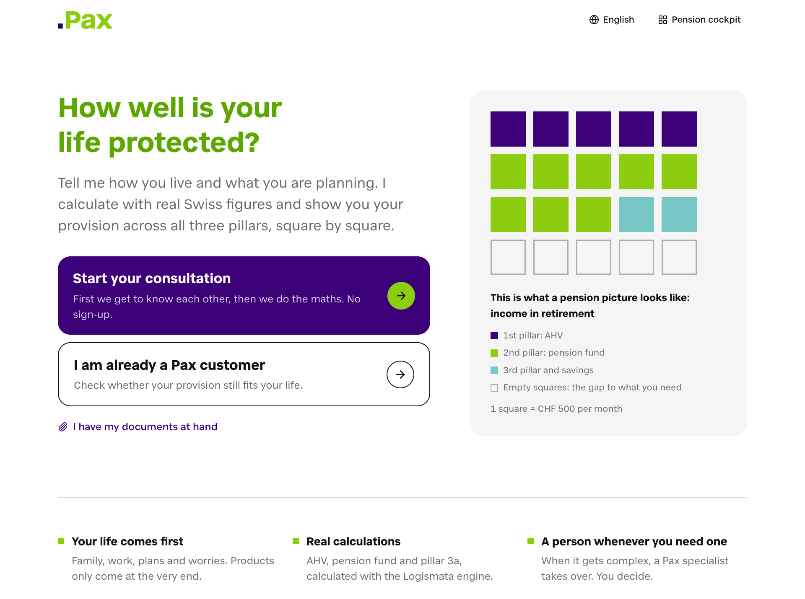

# Pax Clara: a digital pension advisor that starts with your life, not a product

BaselHack 2026, Pax challenge "AI that makes life insurance simple". Team A4: Joel Müller, Flurin Laim.

Clara is a self-service pension advisor for Pax customers. She first gets to know the person
(family, work, plans, worries), then builds their picture across all three pillars with real
Swiss calculations (Logismata), lets them play through life scenarios, and only then recommends
Pax products, with the criteria behind each one and a live Pax premium (Quicksale). The customer
can sign the offer and find the policy in their Vorsorge-Cockpit. On the other side, Pax gets a
company dashboard with leads, handovers to human advisors, funnel drop-offs and the full audit
trail of every conversation.



DE / FR / IT / EN, Swiss-German voice input, an avatar, NPS feedback and product insights are
included.

## Run it

```bash
cd code
pnpm install
cp .env.example .env.local   # ANTHROPIC_API_KEY, LOGISMATA_API_TOKEN, SESSION_SECRET, DOCUMENT_ENCRYPTION_KEY
pnpm db:reset                # SQLite in code/data: advisors, rule set v1, demo customers
pnpm dev                     # http://localhost:3000/de
```

| URL | What |
|---|---|
| `/de` | Start a consultation, or "Ich bin bereits Pax-Kunde" to pick a demo customer |
| `/de/portal` | Vorsorge-Cockpit: policies, documents, hints, conversations |
| `/de/firma` | Company dashboard (password `COMPANY_PASSWORD`, default `pax-demo`) |

More on services, voice and scripts: [`code/README.md`](code/README.md). Demo scripts for the
seeded personas: [`documentation/DEMO_PERSONAS.md`](documentation/DEMO_PERSONAS.md).

## The journey

**advisory → recommendation → contract → policy in the portal**, end to end:

1. **Getting to know you.** Clara asks about the person before any numbers or products.
2. **Numbers, with a shortcut.** Upload a Vorsorgeausweis, policy or Lohnausweis instead of
   typing figures. Extracted values are only used after the customer confirms them.
3. **Analysis.** Logismata risk check (disability, death) and retirement check across all three
   pillars, shown as the Vorsorgebild and gap charts, plus 3a tax savings.
4. **Scenarios.** A child, buying a home with 3a or pension-fund money, early retirement.
5. **Recommendation.** Gap → product, with criteria, alternatives and a Quicksale premium.
   Unit-linked products need the suitability check first.
6. **Contract.** Offer summary → consent → typed-name signature → policy in the cockpit.
7. **Handover** to a human advisor whenever a company rule or the customer asks for it.

Architecture, data model and design decisions: [`documentation/ARCHITECTURE.md`](documentation/ARCHITECTURE.md).

## Legal Framework: where it is implemented

| Requirement | How | Where |
|---|---|---|
| Recommendations are explainable, documented, auditable | Each recommendation is stored with the gap, criteria, alternatives, inputs, premium source, model id and rule-set version; every Logismata and Quicksale call is stored with input and output | [`code/src/lib/sales/recommend.ts`](code/src/lib/sales/recommend.ts), `recommendations` and `calculations` in [`code/src/lib/db/schema.ts`](code/src/lib/db/schema.ts) |
| Logging | Audit log for AI and human actions (recommendations, offers, signatures, document access, handovers, rule changes, lead changes), shown per conversation in the dashboard | [`code/src/lib/audit.ts`](code/src/lib/audit.ts), [`records-section.tsx`](code/src/components/firma/conversation/records-section.tsx) |
| Human review stays possible | The advisor hands over when an active company rule applies (it cites the rule ids), when the customer asks, or when the case is complex. Rules are plain language, versioned and edited by Pax | [`code/src/lib/advisor/tools/handover.ts`](code/src/lib/advisor/tools/handover.ts), [`code/src/lib/rules/active.ts`](code/src/lib/rules/active.ts), `/firma/uebergaben`, `/firma/regeln` |
| Encryption | Uploaded documents are encrypted at rest with AES-256-GCM, the document id bound as authenticated data; the customer can delete them | [`code/src/lib/documents/crypto.ts`](code/src/lib/documents/crypto.ts), [`code/src/app/api/documents/[id]/route.ts`](code/src/app/api/documents/%5Bid%5D/route.ts) |
| Access protection | Signed HMAC customer cookie; company dashboard behind a password with a constant-time check, server actions re-check the advisor | [`code/src/lib/auth/signing.ts`](code/src/lib/auth/signing.ts), [`code/src/lib/firma/auth.ts`](code/src/lib/firma/auth.ts) |
| No uncontrolled external AI | Every model call goes through one module; `LLM_PROVIDER=openai-compatible` points it at a self-hosted vLLM endpoint. Swiss-German speech recognition runs on a Nemotron server we operate ourselves (Nebius GPU) | [`code/src/lib/ai/models.ts`](code/src/lib/ai/models.ts), [`code/src/app/api/transcribe/route.ts`](code/src/app/api/transcribe/route.ts) |
| Formal requirements for the contract | Suitability check before unit-linked products, explicit consent and a signature that must match the customer's name | [`code/src/lib/sales/suitability.ts`](code/src/lib/sales/suitability.ts), [`code/src/lib/sales/application.ts`](code/src/lib/sales/application.ts) |

### Known gaps

- **The demo uses Anthropic's API.** Full customer context goes to Claude today. The self-hosted
  path exists as a config switch but was not what we demoed.
- **No real authentication.** Customers are identified by a device cookie, and the company
  dashboard uses one shared password.
- **Only documents are encrypted.** The SQLite database (profiles, transcripts) is not encrypted
  at rest.
- **The audit log is not tamper-proof.** It is a normal table, not append-only or signed; the demo
  reset in `/firma/wiedervorlagen` even deletes its e-mail entries.
- **No advance privacy notice or consent before the chat starts.** Notices appear only at
  document upload and in the offer.
- **No anti-money-laundering checks** and no identity verification; the signature is a typed name
  and the contract is a mock.

## Repository

| Folder | Content |
|---|---|
| [`code/`](code) | Next.js app (customer PWA and company dashboard) |
| [`documentation/`](documentation) | Architecture and demo personas |
| [`challenge_context/`](challenge_context) | Challenge brief, Pax brand, API notes |
| [`assets/`](assets) | Screenshots |

License: PolyForm Noncommercial 1.0.0, see [`license.txt`](license.txt).
